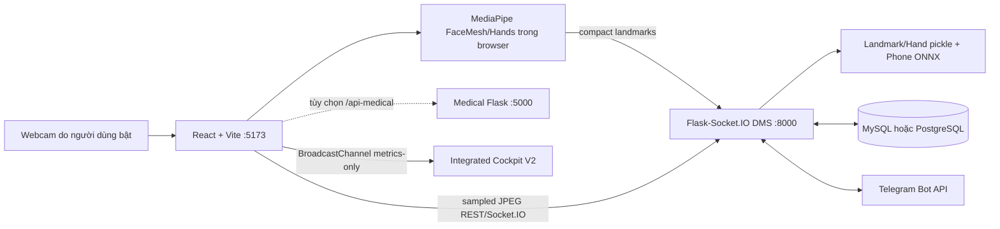
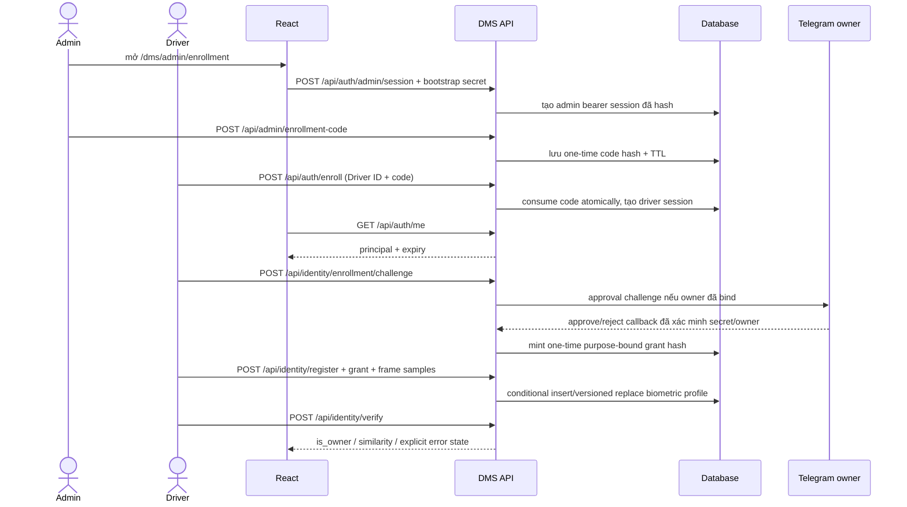
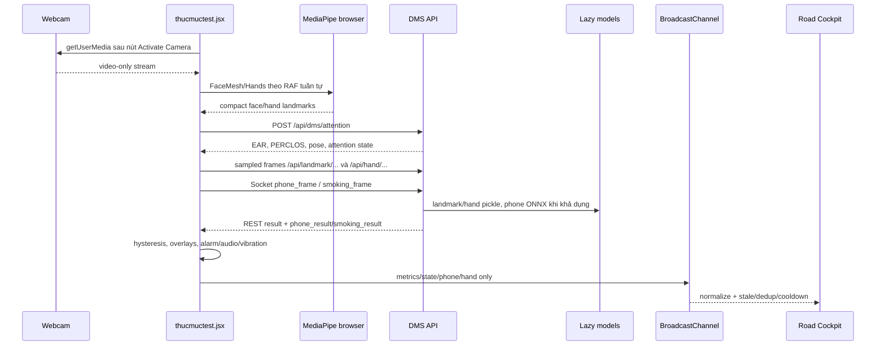
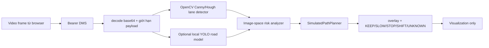
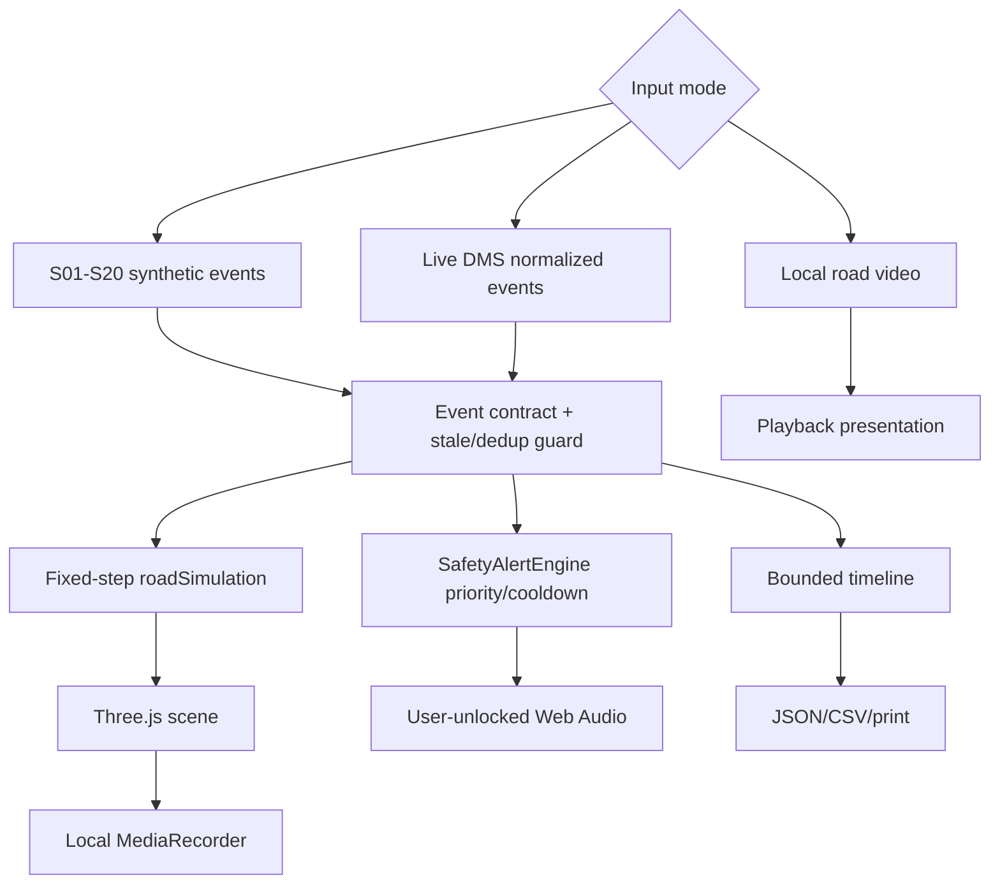

# System Runtime Flow — DMS Master V3

Cập nhật: 2026-11-19. Tài liệu này mô tả đường chạy thực tế từ source, không suy diễn từ tên file.

## 1. Entrypoint và process boundary

| Process | Entrypoint | Port | Vai trò |
|---|---|---:|---|
| React/Vite | `frontend/demothuattoanpro/src/main.jsx` → `App.jsx` | 5173 HTTPS dev | route, camera UI, MediaPipe browser, dashboard |
| DMS API | `backend/app.py` → `data/api/api.py` | 8000 | auth, identity, DMS/ADAS inference, Telegram, sessions, Socket.IO |
| Medical legacy | `backend/len.py` | 5000 | JWT, medical record/symptom/image APIs; độc lập với DMS |
| Training/tooling | `backend/driver_training/**`, `quicktest.py` | không có | collect/train/smoke offline; không được import vào server request path |

`backend/app.py` dùng threading trên Windows và Eventlet trên Linux. DMS model, MediaPipe và
ADAS object model đều lazy-load; server startup không chứng minh inference đã load.



## 2. Frontend route graph

```mermaid
flowchart TD
  Main[main.jsx] --> App[App.jsx / BrowserRouter]
  App --> Public[/ landing]
  App --> Medical[/login /admin /spam /test1 /test2]
  App --> AdminEnroll[/dms/admin/enrollment]
  App --> Protected[DmsProtectedRoute]
  Protected --> DMSUI[/test3 DMS]
  Protected --> Hand[/test4 Hands]
  Protected --> Face[/test5 Identity]
  Protected --> ADAS[/adas-simulation]
  App --> Road[/demo/road-driving lazy-loaded]
```

`DmsProtectedRoute` kiểm tra bearer bằng `/api/auth/me` lúc mount và khi tab focus. 401/403 xóa
phiên local; network failure khóa nội dung nhưng giữ token để retry. Medical có JWT/storage riêng,
không được dùng thay DMS bearer.

## 3. Auth, enrollment, face và Telegram



Face embedding được tạo từ FaceMesh landmarks ở backend; max hai mặt để phát hiện và từ chối
`multiple_faces`. Face matching hiện không có PAD/liveness đã kiểm chứng. Kết quả face không tự
mint protected session. Profile API chỉ trả metadata, không trả ảnh/embedding.

Telegram binding: driver lấy bind code từ `/api/identity/telegram/bind-code`, sau đó owner nhắn
`/bind <code>`. Webhook xử lý command và callback; token/webhook secret không được log/trả về client.
Approval tạo grant ngắn hạn, bind đúng driver + auth session + purpose và consume một lần.

## 4. Luồng DMS webcam → MediaPipe → backend → alert



Backend là nguồn tính EAR/PERCLOS/head pose/attention cho compact landmark payload. UI cũng vẽ
overlay và duy trì presentation state. Frame sampling có single-flight/pending guard; không gửi
mỗi render frame đồng thời. `UNKNOWN`/`UNAVAILABLE` không được chuyển thành `NORMAL`.

Kênh `dms-attention-v2` chỉ copy attention state, face flag, eye state, EAR, PERCLOS, head pose,
phone flag, hand gesture, reason và model status. Token, raw image và landmarks không qua kênh.

## 5. ADAS `/adas-simulation`



Lane detector là xử lý ảnh thật khi có frame. Object detector chỉ load model local, không download;
repository hiện thiếu `road_yolo.pt`, nên object status là `model_missing`. Planner chỉ tạo gợi ý
hiển thị và đường cong overlay; không có CAN, steering, throttle hay brake output.

## 6. Integrated Cockpit V2 `/demo/road-driving`

Cockpit có ba input mode:

| Mode | Nguồn | Tính chất |
|---|---|---|
| Scenario S01–S20 | seeded deterministic world | hoàn toàn synthetic, reproducible |
| Live DMS | `BroadcastChannel` từ tab DMS | metrics thật nếu camera/backend thật đang chạy; road world vẫn simulation |
| Road video | file video local | playback/recording; chưa nối ADAS road analysis vào cockpit |



Mọi snapshot giữ `simulationOnly=true` và `productionControlOutput=null`. S01–S20 kiểm tra brake,
lane clearance, continuous lane change, abort, stop và recovery trong thế giới ảo, không phải ADAS
điều khiển xe thật.

## 7. Driving session và history

1. Client tạo authorization challenge với purpose `START_DRIVING_SESSION`.
2. Admin/Telegram owner approve đúng challenge.
3. Backend mint grant hash với TTL, driver, auth-session hash và purpose.
4. `/api/driving/session/start` consume grant atomically và tạo session.
5. `/api/driving/session/alert` ghi alert của đúng owner/session.
6. `/api/driving/session/end` đóng session.
7. `/api/driving/sessions` và `/api/driving/session/<id>` kiểm tra owner/admin trước khi trả history.

Legacy aliases `/api/authorization/challenge/<id>` và admin alias vẫn được giữ để không phá contract.

## 8. Trạng thái inference trung thực

| Khối | Trạng thái audit | Ghi chú |
|---|---|---|
| Browser FaceMesh/Hands | code khả dụng; webcam E2E chưa chạy | tải MediaPipe browser runtime khi UI active |
| Backend attention | thực, deterministic theo landmark/time | EAR/PERCLOS/head pose, không phải classifier giả |
| Landmark classifier | artifact có; lazy-load | test loader/fail-safe PASS |
| Hand classifier | artifact có; lazy-load | có thể tắt để tiết kiệm RAM |
| Phone detector | ONNX artifact có; lazy-load | audit health trước request: `loaded=false` là bình thường |
| Smoking | unavailable | không có model được xác minh; REST/Socket fail-closed |
| ADAS lane | thực trên input frame | OpenCV image-space only |
| ADAS road objects | unavailable | thiếu local road model |
| Cockpit S01–S20 | synthetic | không được trình bày là sensor/inference thật |
| Medical symptom model | train/load từ DB lúc chạy Medical | legacy, độc lập DMS |
| Medical image model | unavailable | thiếu hai artifact; trả 503 |

## 9. API surface chính

- Auth: `/api/auth/admin/session`, `/api/admin/enrollment-code`, `/api/auth/enroll`,
  `/api/auth/me`, `/api/auth/logout`.
- Inference: `/api/landmark/*`, `/api/hand/*`, `/api/phone/*`, `/api/smoking/*`,
  `/api/dms/attention`, `/api/adas/process-frame`.
- Identity/Telegram: `/api/identity/*`, `/api/telegram/webhook`.
- Driving: `/api/driving/authorization/*`, `/api/driving/session/*`, `/api/driving/sessions`.
- Socket.IO: client emits `phone_frame`, `smoking_frame`; server emits `phone_result`,
  `smoking_result`.
- Health: `/`, `/health`, `/api/ping-db`.

## 10. Ranh giới chưa xác minh

Browser visual/audio/fullscreen/MediaRecorder, webcam thật, real model quality, Telegram thật,
PostgreSQL/MySQL production, liveness/PAD và deployment proxy chưa được E2E trong audit này.
HTTP 200 của SPA route chỉ xác nhận dev server fallback, không xác nhận component đã mount đúng trong
browser. Không gọi hệ thống production-ready hoặc safety-certified từ các test hiện có.
