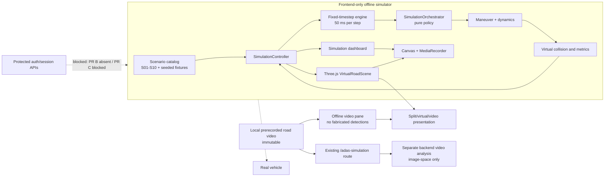
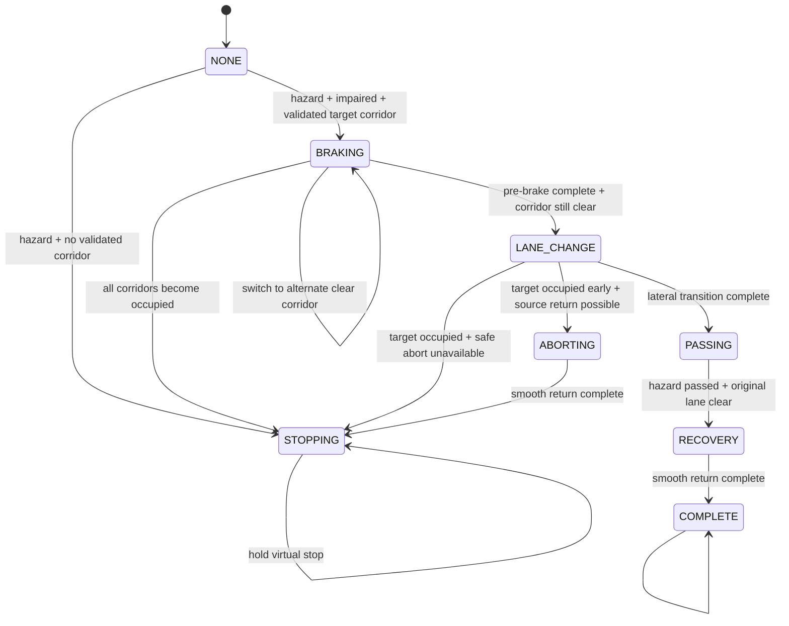

# Kiến trúc mô phỏng lái xe đường bộ DMS + ADAS

## 1. Phạm vi và trạng thái an toàn

Module này là một **trình mô phỏng frontend, offline, xác định (deterministic)**. Nó tạo một thế giới đường bộ tổng hợp có tọa độ biết trước, điều khiển một xe EGO ảo và hiển thị chuyển động bằng Three.js. Mọi quyết định `KEEP_LANE`, `SLOW_DOWN`, `STOP`, `SHIFT_LEFT` và `SHIFT_RIGHT` chỉ là ý định bên trong mô phỏng.

Module không phải là hệ thống lái tự động, không phát lệnh tới xe thật và không chứng minh khả năng tránh tai nạn trong thế giới thật. Các trường bảo vệ sau phải luôn giữ nguyên trong snapshot:

- `safety.simulationOnly = true`;
- `safety.realVehicleControlCapable = false`;
- `safety.productionControlOutput = null`;
- `orchestrator.productionControlOutput = null`;
- `safety.virtualDistancesOnly = true`.

Tại baseline hiện tại:

- PR B chưa tồn tại: chưa có server-side verification challenge/grant, auth-session binding hay atomic grant consumption;
- PR C bị chặn bởi PR B: secure biometric enrollment, privacy lifecycle và fresh-browser flow chưa được triển khai;
- `POST /api/driving/session/start` chưa có security proof bắt buộc;
- vì vậy simulator không gọi API để tạo phiên lái được bảo vệ, không cấp quyền phiên lái và không tuyên bố secure end-to-end;
- S10 chỉ tạo timeline cục bộ, `persisted: false`, với trạng thái integration bị chặn rõ ràng.

Việc tách simulator offline là một containment boundary, không phải cách đi vòng security gate. Chỉ được nối simulator vào protected workflow sau khi PR B và PR C có implementation evidence cùng regression/integration tests tương ứng.

## 2. Mục tiêu và phi mục tiêu

### Mục tiêu

- Cho thấy xe EGO thực sự chuyển động liên tục trong một thế giới ảo ba làn.
- Mô phỏng phanh, dừng, đổi làn, vượt và quay lại làn bằng động học có giới hạn.
- Chỉ đổi làn khi hành lang ảo được kiểm tra là còn trống.
- Đánh giá lại khi vật cản mới xuất hiện trong làn đích.
- Có kết quả lặp lại theo scenario, seed, cấu hình và timestep.
- Giữ tách biệt tuyệt đối giữa video đường thật đã ghi và chuyển động trong scene ảo.
- Cho phép Play/Pause/Resume/Reset, đổi tốc độ phát và đổi góc camera.
- Hỗ trợ ghi canvas mô phỏng cục bộ nếu trình duyệt hỗ trợ.

### Phi mục tiêu

- Không điều khiển vô-lăng, phanh, ga, CAN bus hay bất kỳ actuator thật nào.
- Không sửa quỹ đạo trong video prerecorded và không gọi overlay là chuyển động xe thật.
- Không suy ra khoảng cách thật, vận tốc tương đối thật hay TTC thật từ camera.
- Không biến obstacle tổng hợp thành dự đoán của model.
- Không dùng DMS synthetic fixture làm bằng chứng accuracy, FAR/FRR, liveness hoặc độ an toàn.
- Không tạo một authentication/session API thay thế PR B.
- Không ghi, tải lên hoặc persist ảnh camera/biometric.

## 3. Hai miền dữ liệu không được trộn

| Miền | Nguồn | Có thể thay đổi quỹ đạo? | Đơn vị/khoảng cách | Cách diễn giải bắt buộc |
|---|---|---:|---|---|
| Road video | File video prerecorded do người dùng chọn | Không | Pixel/image-space | Khung hình thật đã ghi là bất biến; lane/object/risk/path chỉ là overlay phân tích |
| Virtual driving | Fixture S01–S10 và engine frontend | Có, chỉ với xe ảo | Mét, giây, m/s trong tọa độ tổng hợp | Mô phỏng xác định; mọi distance/TTC/clearance chỉ hợp lệ trong virtual world |
| DMS fixture | Event scenario hoặc input cục bộ | Chỉ ảnh hưởng policy ảo | Trạng thái định danh | `NORMAL`, `DROWSY`, `DISTRACTED`, `HIGH_RISK`, `UNKNOWN`; không phải kết quả model đã được xác nhận |
| Protected DMS/session | Backend hiện hữu | Không được nối ở baseline này | API/database | Chưa an toàn E2E vì PR B vắng mặt và PR C bị chặn |

Chế độ split view chỉ đồng hiển thị hai miền. Nó không đồng nghĩa rằng vật cản ảo trùng với vật thể trong video, hoặc thao tác đổi làn ảo đã thay đổi xe xuất hiện trong video. Nếu road object model không sẵn sàng hoặc chưa được validation, UI phải hiển thị rõ `OBJECT DETECTION UNAVAILABLE`; không tạo bounding box giả.

## 4. Sơ đồ thành phần



Không có cạnh runtime hợp lệ từ simulator tới xe thật. Cạnh tới protected workflow là dependency bị chặn, không phải integration đã hoàn thành.

## 5. Cấu trúc module

| File | Trách nhiệm |
|---|---|
| `src/simulation/constants.js` | Enum DMS/ADAS/assistance/maneuver/run state và cấu hình mặc định |
| `src/simulation/scenarios.js` | Catalog S01–S10, obstacle fixture, timed event, seed normalization và PRNG |
| `src/simulation/SimulationOrchestrator.js` | Policy thuần: kết hợp driver state, perception, front hazard, lane clearance và maneuver hiện tại |
| `src/simulation/roadSimulation.js` | World state, fixed-step update, dynamics, lane clearance, collision prediction, maneuver state machine, metrics và controller |
| `src/simulation/simulationLoop.js` | Adapter `requestAnimationFrame`; giới hạn real-frame delta và cleanup callback khi stop/unmount |
| `src/simulation/VirtualRoadScene.jsx` | Three.js renderer, đường/làn/cảnh quan/xe/vật cản, camera follow và dispose tài nguyên |
| `src/simulation/presentation.js` | Copy trình bày scenario, DMS metrics tổng hợp và lane availability cho UI |
| `src/simulation/recording.js` | Chọn MIME, vẽ composite virtual canvas + simulation labels và ánh xạ extension |
| `src/simulation/RoadDrivingDemo.jsx` | Route-level UI, controller/loop ownership, view/camera controls, local video object URL, readouts, timeline và recording lifecycle |
| `src/simulation/RoadDrivingDemo.css` | Layout responsive, split-view, status/accessibility presentation và simulation-only styling |
| `src/simulation/index.js` | Public exports của simulation domain |
| `src/App.jsx` | Đăng ký route offline `/demo/road-driving`; giữ nguyên route video cũ `/adas-simulation` |

Các thành phần backend ADAS cũ (`data/adas/*`, `/api/adas/process-frame`) vẫn thuộc pipeline phân tích video riêng ở `/adas-simulation`. Chúng không phải physics/collision engine của thế giới ảo và không được dùng làm nguồn khoảng cách thật cho simulator. Offline route `/demo/road-driving` không gọi pipeline này: video pane chỉ phát file local, luôn ghi `OBJECT DETECTION UNAVAILABLE` và không bịa lane/object overlay.

## 6. Mô hình thế giới và hệ tọa độ

World state dùng đơn vị SI trong miền ảo:

- `s`: tọa độ dọc đường, đơn vị mét;
- `x`: tọa độ ngang, đơn vị mét;
- `speed`: m/s;
- `acceleration`: m/s²;
- `heading`: radian tương đối so với trục đường;
- lane đánh số từ trái sang phải, mặc định `0, 1, 2`;
- lane center được tính từ `laneCount` và `laneWidth`;
- xe/vật cản có bounding rectangle theo `length` và `width`.

Mặc định EGO bắt đầu ở làn giữa. Static obstacle có `speed = 0`; dynamic obstacle được cập nhật dọc đường bằng vận tốc fixture. Tất cả obstacle trong scenario mang `synthetic: true`.

### Tham số động học mặc định

| Tham số | Giá trị | Ý nghĩa trong mô phỏng |
|---|---:|---|
| `fixedTimeStep` | 0,05 s | 20 bước logic mỗi giây mô phỏng |
| `laneCount` | 3 | Ba làn tổng hợp |
| `laneWidth` | 3,6 m | Bề rộng làn ảo |
| `cruiseSpeed` | 18 m/s | Tốc độ hành trình mục tiêu, khoảng 64,8 km/h |
| `maximumSpeed` | 28 m/s | Giới hạn tốc độ ảo |
| `maximumAcceleration` | 2,4 m/s² | Giới hạn tăng tốc |
| `comfortableBrake` | 3,5 m/s² | Mức giảm tốc thông thường |
| `maximumBrake` | 7 m/s² | Giới hạn giảm tốc trong engine |
| `unknownPerceptionSpeed` | 4 m/s | Mục tiêu giảm tốc khi perception không chắc chắn |
| `collisionPredictionHorizon` | 3,25 s | Horizon dự đoán va chạm ảo |
| `laneClearanceHorizon` | 3,5 s | Horizon swept-clearance của làn đích |
| `frontLaneClearance` | 18 m | Khoảng hở dọc yêu cầu phía trước trong làn đích |
| `rearLaneClearance` | 12 m | Khoảng hở dọc yêu cầu phía sau trong làn đích |
| `hazardDistance` | 58 m | Ngưỡng xem xét front hazard ảo |
| `preLaneChangeBrakeSeconds` | 0,65 s | Phanh trước khi bắt đầu dịch ngang |
| `laneChangeDuration` | 2,8 s | Thời lượng chuyển làn liên tục |
| `stopBuffer` | 5 m | Buffer dừng trước vật cản ảo |

Các giá trị này là tham số demo, không phải giới hạn đã được hiệu chuẩn cho xe thật.

## 7. Clock xác định và vòng lặp render

Physics không dùng trực tiếp FPS của trình duyệt. `requestAnimationFrame` chỉ cung cấp elapsed wall-clock; engine dùng accumulator để chuyển elapsed time thành số bước nguyên:

```text
scaledElapsed = elapsedSeconds × playbackRate
total         = previousAccumulator + scaledElapsed
stepCount     = floor(total / fixedTimeStep)
remainder     = total - stepCount × fixedTimeStep
```

Mỗi bước logic luôn dài 0,05 s. Adapter giới hạn một frame delta ở 0,25 s để tránh một tab bị treo tạo bước nhảy wall-clock quá lớn. `playbackRate` chỉ thay đổi số bước logic tiêu thụ theo thời gian thực, không đổi phương trình bên trong một bước.

Hệ quả:

- cùng scenario, seed, config và chuỗi input cho cùng state/metrics;
- tốc độ render khác nhau không làm đổi kết quả logic kỳ vọng;
- Pause không tiến clock;
- Resume tiếp tục state hiện tại;
- Reset tạo lại state ban đầu từ cùng scenario/seed;
- renderer có thể bỏ frame hình ảnh nhưng không được bỏ bước physics đã tích lũy;
- đây là tính xác định logic, không cam kết pixel-perfect giữa GPU/trình duyệt.

## 8. Thứ tự xử lý một bước mô phỏng

`stepSimulation` thực hiện theo thứ tự:

1. Clone immutable snapshot cần thiết và tăng `time`/`stepCount`.
2. Áp timed events chưa dùng: driver state, perception, obstacle activation hoặc local session/alert.
3. Cập nhật vị trí dọc của dynamic obstacles.
4. Tích lũy thời gian warning khi driver thuộc nhóm impaired.
5. Tìm front hazards bằng virtual bounding geometry và constant-velocity prediction.
6. Đánh giá clearance của làn trái/phải trong virtual horizon.
7. Gọi `evaluateSimulationOrchestrator` để lấy policy.
8. Cập nhật maneuver phase; có thể bắt đầu phanh, đổi corridor, chuyển làn, abort hoặc safe stop.
9. Đánh giá lại policy sau transition để snapshot UI phản ánh đúng phase vừa vào.
10. Tính acceleration bị giới hạn và tích phân vận tốc/vị trí dọc.
11. Cập nhật chuyển động ngang bằng smoothstep liên tục.
12. Cập nhật minimum virtual clearance và collision count.
13. Khi hết duration, đánh dấu `COMPLETE`; tái khẳng định mọi production output là `null`.

## 9. SimulationOrchestrator

Orchestrator là hàm policy thuần; nó không render, không gọi API và không có side effect. Input gồm:

- driver attention state;
- warning elapsed;
- virtual perception availability/lane geometry;
- front hazard ảo;
- left/right lane clearance;
- maneuver đang hoạt động.

Quy tắc ưu tiên:

1. Perception hoặc lane geometry không biết → `UNKNOWN`, yêu cầu controlled slowdown, không chọn làn.
2. Maneuver đang hoạt động → duy trì/hoàn tất/abort nhất quán; driver phục hồi không làm teleport.
3. Driver `UNKNOWN` → `UNKNOWN`, không chuyển làn mù.
4. Driver `NORMAL` → giữ làn; nếu có hazard thì chỉ yêu cầu giảm tốc, không tự đổi làn.
5. Driver impaired nhưng không có hazard → cảnh báo, vẫn `KEEP_LANE`.
6. Driver impaired + hazard nhưng escalation chưa đủ → cảnh báo và giảm tốc.
7. Escalation đủ + hành lang trái rõ → đề xuất trái.
8. Nếu trái không rõ nhưng phải rõ → đề xuất phải.
9. Không có corridor hợp lệ → `STOP`.

“Driver mất tập trung” một mình không phải lý do đánh lái. Việc chuyển làn chỉ phát sinh khi đồng thời có hazard ảo và corridor ảo đã được kiểm tra.

## 10. Maneuver state machine



Chuyển động ngang dùng smoothstep `p²(3−2p)` giữa `lateralStartX` và `lateralEndX`, không gán lane position tức thời. EGO chỉ đổi `currentLane` khi transition hoàn tất. Heading được suy ra từ lateral delta trên quãng dọc mỗi step.

Khi obstacle mới vào target lane:

- nếu progress chưa vượt abort threshold và nguồn cũ còn an toàn, xe quay lại liên tục rồi dừng;
- nếu quay lại không an toàn, engine chọn phanh/dừng thay vì tiếp tục chuyển làn mù;
- engine không cam kết tìm được quỹ đạo tránh va chạm trong mọi cấu hình.

## 11. Virtual collision và lane clearance

### Collision hiện tại

`hasVirtualCollision` kiểm tra overlap của hai bounding rectangles theo cả trục dọc và ngang. `virtualClearance` lấy khoảng cách Euclid giữa hai rectangle sau khi trừ half-extents. Một obstacle chỉ tăng collision count một lần theo ID.

### Prediction hiện tại

`predictVirtualCollision` dùng:

- overlap ngang tại state hiện tại;
- bumper gap dọc;
- closing speed không đổi;
- horizon hữu hạn.

Đây là constant-velocity prediction đơn giản trong world state đã biết. Nó không mô hình hóa steering dynamics đầy đủ, tire friction, độ dốc, thời tiết, sensor uncertainty hay behavior của người lái khác.

### Lane clearance

Với mỗi obstacle có overlap ngang với center của target lane, engine ước lượng swept longitudinal center distance trong horizon. Corridor bị chặn khi body clearance thấp hơn front/rear requirement. Lane ngoài road boundary, perception unavailable hoặc lane geometry unknown đều trả `clear: false`.

`evaluateLaneClearance` là contract ra quyết định của engine. Helper `laneAvailability` trong `presentation.js` chỉ tạo readout gần EGO cho UI từ một cửa sổ khoảng cách đơn giản; nó không được dùng để cấp quyền chuyển làn, thay thế swept-clearance hoặc tuyên bố corridor an toàn.

Mọi kết quả mang `virtualOnly: true`. Các giá trị `timeToCollision`, `minimumPredictedClearance`, `minimumVirtualClearance` và `timeToVirtualStop` tuyệt đối không được hiển thị như số đo từ road video.

## 12. Three.js scene và lifecycle

`VirtualRoadScene` dựng:

- mặt đường ba làn và vạch phân làn;
- lề/cảnh quan cây đơn giản;
- xe EGO;
- xe/vật cản tĩnh hoặc động từ snapshot;
- ánh sáng, shadow và fog;
- camera `DRIVER`, `REAR` và góc quan sát bên ngoài.

Scene không tự quyết định physics. Nó đọc snapshot từ engine và đặt mesh theo `ego.x`, `ego.s`, `heading` cùng obstacle positions. Camera bám EGO theo mỗi render frame.

Lifecycle bắt buộc:

- `ResizeObserver` cập nhật renderer/camera aspect;
- animation loop dừng khi unmount;
- observer bị disconnect;
- obstacle mesh bị remove/dispose khi không còn;
- toàn bộ geometry/material và renderer được dispose;
- canvas reference được trả về `null` cho consumer khi cleanup.

Three.js animation FPS chỉ ảnh hưởng độ mượt hình ảnh, không điều khiển physics clock.

## 13. Presentation, playback và accessibility

Route `/demo/road-driving` cung cấp:

- badge luôn thấy được: `SIMULATION ONLY — NO VEHICLE CONTROL`;
- scenario selector S01–S10;
- Play/Pause/Resume/Reset;
- playback rate trong giới hạn controller cho phép;
- camera driver/rear/external;
- driver attention, assistance mode, decision, speed và lane;
- lane availability, timeline và obstacle/maneuver events;
- EAR/PERCLOS/head pose fixture phải ghi rõ là synthetic;
- status không dựa vào màu đơn lẻ; canvas có accessible label và control có text/ARIA phù hợp.

Route có ba view mode `SPLIT`, `VIRTUAL`, `VIDEO`. Nút chạy/tạm dừng/reset và playback rate được áp dụng cho simulation; khi có local video, UI cố phát/tạm dừng/reset video cùng thao tác và đặt cùng playback rate. Đây chỉ là đồng bộ điều khiển trình diễn, không phải timestamp registration giữa video pixels với virtual world. Link sang `/adas-simulation` mở pipeline video hiện hữu như một route riêng; nó không truyền detections vào virtual engine.

Hướng dẫn chạy và kết quả browser/manual được ghi trong handoff/test report riêng. Tài liệu kiến trúc này không coi sự tồn tại của route là bằng chứng route đã được manual-validated.

## 14. Ghi hình demo

Recording chỉ lấy canvas Three.js và overlay trạng thái mô phỏng cục bộ. MIME được chọn theo khả năng thật của `MediaRecorder.isTypeSupported`, ưu tiên:

1. WebM/VP9;
2. WebM/VP8;
3. WebM;
4. MP4/H.264;
5. MP4.

MP4 chỉ được cung cấp khi browser báo hỗ trợ; nếu không, UI phải nói rõ unavailable. Không upload cloud. Không ghi microphone theo mặc định. Không đưa road webcam, face image hoặc biometric frame vào recording nếu chưa có một consent flow riêng, rõ ràng và có thể thu hồi.

Giới hạn:

- `captureStream`/`MediaRecorder` không đồng nhất giữa browser;
- tab background, GPU reset hoặc canvas taint có thể làm ghi hình thất bại;
- recording không phải evidence về timing hard-real-time;
- file đầu ra là demo của virtual canvas, không phải dữ liệu lái xe thật.

## 15. Security và privacy boundary

- Simulator không cần bearer token để chạy fixture offline.
- Không gọi session start/history/alert API.
- Không mint, nhận, cache hoặc consume verification/enrollment grant.
- Không đọc hoặc persist raw biometric.
- Không gửi frame, metric hay recording ra external service.
- Không dùng local timeline như database audit trail.
- Local session S10 không phải authenticated driving session.
- Không được thêm bearer-only fallback khi nối integration về sau.

Sau khi PR B/PR C hoàn thành, adapter tích hợp phải là module riêng, fail closed và giữ engine thuần. Protected start chỉ được xảy ra sau atomic consume của purpose-specific grant; simulator vẫn không được nhận khả năng vehicle control.

## 16. Testable invariants

Các invariant kiến trúc cần có regression coverage:

- cùng seed/config/input → cùng final state và metrics;
- phân mảnh elapsed time khác nhau → cùng fixed-step result;
- Pause không tiến state; Reset khôi phục cùng fixture;
- acceleration/braking không vượt config;
- lateral position thay đổi liên tục, không teleport;
- không đổi sang lane ngoài road hoặc lane không clear;
- driver impaired nhưng không hazard → không swerving;
- perception unknown → không lane change;
- target lane mới occupied → re-evaluate/abort/stop;
- collision count và clearance chỉ dùng virtual coordinates;
- mọi snapshot có `productionControlOutput: null`;
- S10 không gọi protected API và không persist local events;
- unmount dừng callback, observer, renderer và recording resources;
- UI/recording luôn giữ nhãn simulation-only.

Số lượng test, kết quả gate, commit và push status thuộc `ROAD_SIMULATION_TEST_REPORT.md` và `ROAD_SIMULATION_HANDOFF.md`; không được suy ra từ tài liệu thiết kế này.

## 17. Hạn chế và validation còn thiếu

- Chưa có vehicle dynamics model đã hiệu chuẩn, road friction hay actuator latency.
- Bounding-box collision là mô hình hình học đơn giản.
- Không có sensor noise/occlusion/calibration/depth từ camera thật.
- Không có chứng nhận ISO 26262, SOTIF, NCAP hoặc safety case.
- Không có real-time guarantee; browser event loop có thể bị trì hoãn.
- Không có validation với track/xe thật và không được thực hiện trong phạm vi demo.
- Road video pipeline hiện có image-space risk; không được trộn với metric mét/giây của simulator.
- Three.js scene là trình diễn kỹ thuật, không phải digital twin của tuyến đường.
- PR B absent và PR C blocked; secure E2E/session/history vẫn chưa có.

Ngôn ngữ công bố hợp lệ: “trình mô phỏng deterministic trong tọa độ ảo đã biết”. Ngôn ngữ không hợp lệ: “xe đã tránh tai nạn”, “khoảng cách camera đo được”, “ADAS tự lái an toàn”, “đã hoàn thành secure E2E” hoặc “đã được validation cho xe thật”.
